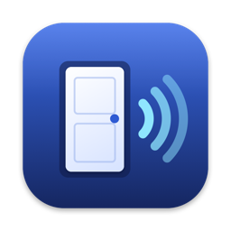
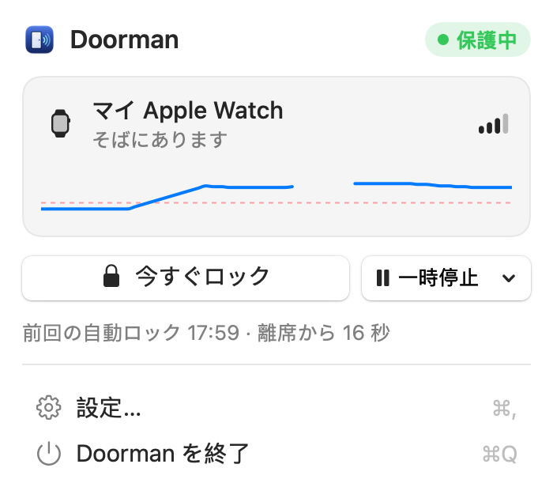
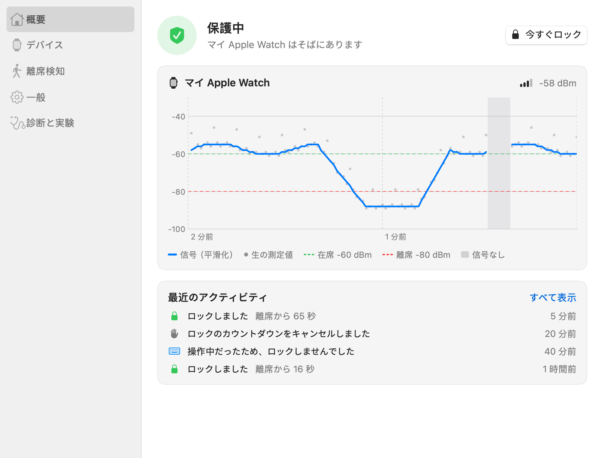
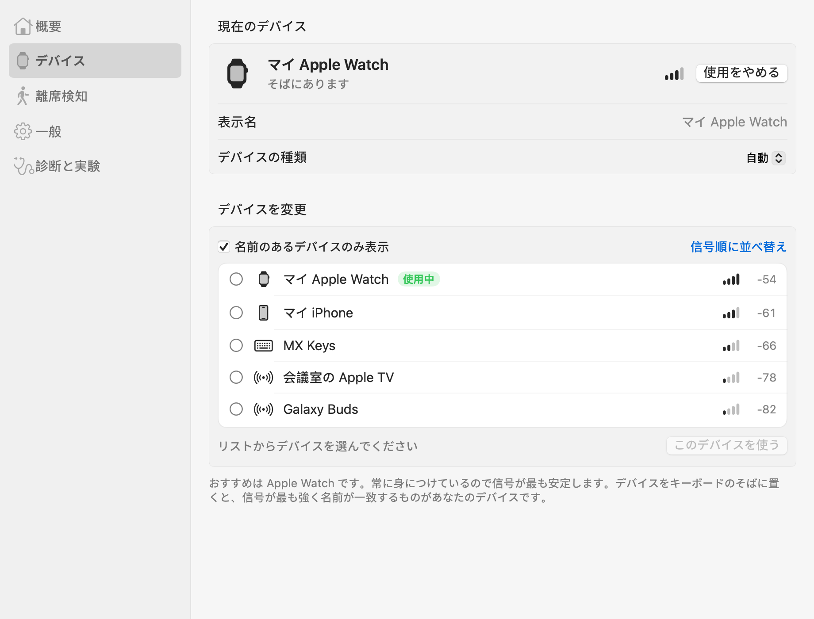
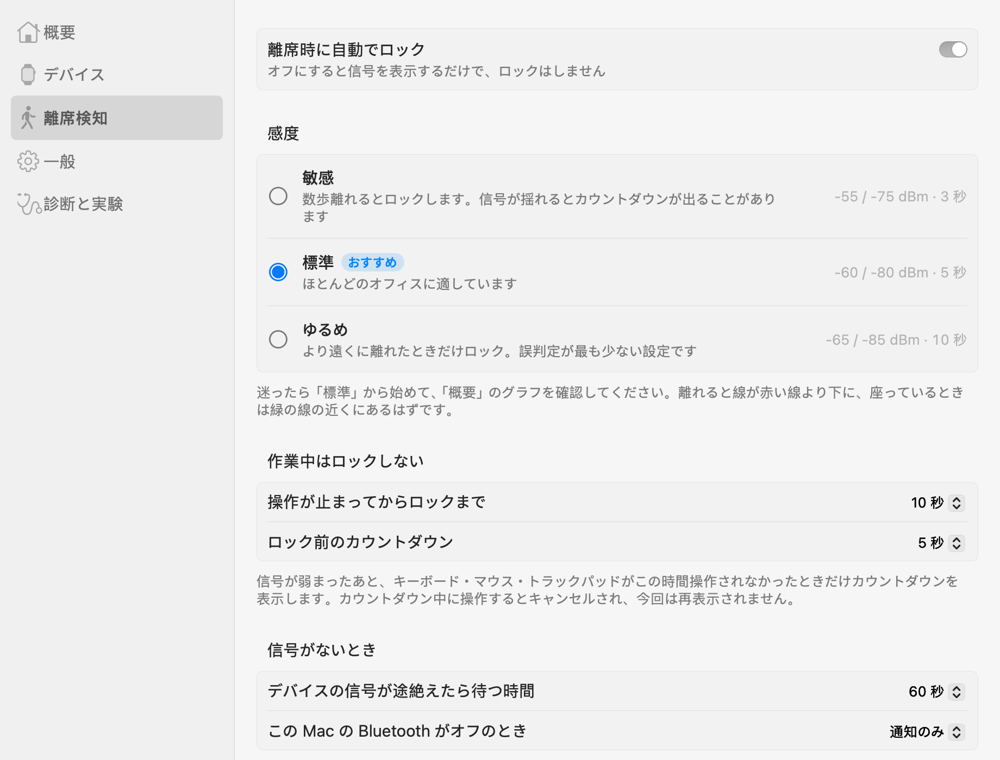
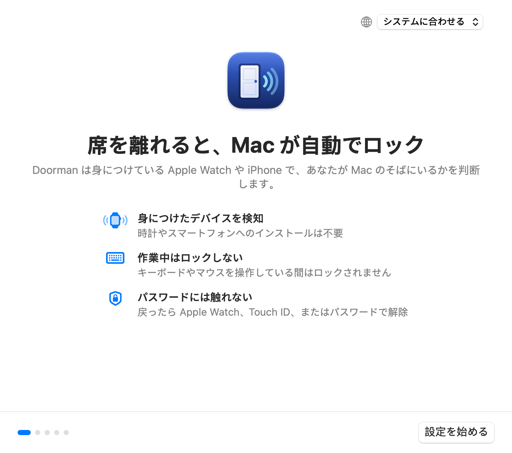

<p align="center">
  
</p>

<h1 align="center">Doorman</h1>

<p align="center">席を離れると、Mac が自動でロックされます。</p>

<p align="center">
  <a href="README.md">English</a> · <a href="README.zh-CN.md">简体中文</a> · <b>日本語</b> · <a href="https://hodgekou.github.io/doorman/">Web サイト</a>
</p>

---

Doorman は軽量な macOS メニューバーアプリです。身につけている Apple Watch や iPhone の Bluetooth 信号から、あなたが Mac のそばにいるかを判断し、離れたら Mac をロックします。戻ったときのロック解除は macOS に任せます（Apple Watch でロック解除、Touch ID、パスワード）。Doorman がログインパスワードを保存したり、代わりに入力したりすることはありません。

> **現在の状況：** 初期開発段階（M1）です。ロック動作はさらに多くの実機での検証が必要です。[ロードマップ](#ロードマップ)をご覧ください。

## スクリーンショット

| メニューバー | 概要 |
|---|---|
|  |  |

| デバイスの選択 | 離席検知 |
|---|---|
|  |  |

| ロック前のカウントダウン | 初回ガイド |
|---|---|
|  |  |

## 機能

- **離れたらロック。** いつも身につけている Apple Watch や iPhone の信号を使います。時計やスマートフォンに何もインストールする必要はありません。
- **作業中はロックしない。** 直近にキーボード・マウス・トラックパッドの操作があれば自動ロックしません。ロック前に 5 秒のカウントダウンが表示され、何か操作すればキャンセルされます。ロックを実行する直前にも操作がないかを再確認するので、最後の瞬間の操作も有効です。
- **パスワードには触れない。** ロック解除は macOS に任せます（Apple Watch でロック解除、Touch ID、パスワード）。
- **状態を正直に表示。** 自動ロックが使えるのか、通知のみなのか、準備ができていないのか、そしてどう直せばよいかをメニューバーで常に確認できます。
- **リアルタイムの信号グラフと 3 段階のプリセット。** 直近 2 分間の信号を確認でき、感度は dBm を調整する代わりに「敏感 / 標準 / ゆるめ」から選べます。
- **診断データはローカルのみ。** ロックの試行はすべてお使いの Mac 上に記録されます（最大 30 日・500 件）。外部には送信しません。
- **日本語・English・简体中文に対応。** 既定ではシステムの言語に従います。「設定 › 一般」でいつでも切り替えられ、すぐに反映されます。

## 仕組み

```
Bluetooth RSSI ─▶ 中央値フィルタ ─▶ 在席状態：近く / 離れつつある / 離席 / 信号なし
                                         │ ロックしたい
                                         ▼
        アクティビティガード：キーボード・マウスが 10 秒以上操作されていない？
          いいえ → 保留して監視を続ける
          はい   → 5 秒のカウントダウン（操作があればこの回はキャンセル）
                                         │
                                         ▼
    実行前の再確認：操作がないかを再取得、ラウンド ID とセッション状態を確認
                                         │
                                         ▼
               画面をロック ─▶ セッション信号でロックを確認
```

- 信号強度（RSSI）はおおまかな近さの目安にすぎません。2 つのしきい値の間に余裕を持たせて（既定値 −60 / −80 dBm）、境界付近での状態の行き来を防ぎます。
- デバイスの信号が完全に途絶えた場合、60 秒（変更可能）待ってから信号なしと判断します。
- スリープから復帰したあとは、まず信号を取り直してから判断します。15 秒以内にデバイスが見つからなければロックせず「準備ができていません」と表示します。

## 動作環境

- macOS 13 Ventura 以降（Apple シリコンまたは Intel）
- Bluetooth Low Energy に対応した Mac
- Apple Watch または iPhone（Mac と同じ Apple ID でサインインしているのが理想）、あるいはアドレスが固定された他の Bluetooth LE デバイス

## インストール

Doorman はまだ公証（notarization）されていないため、ソースからビルドしてください。必要なのは Xcode Command Line Tools だけです。

```sh
git clone https://github.com/hodgekou/doorman.git
cd doorman
scripts/install.sh    # ビルドして /Applications/Doorman.app にインストールし、起動します
```

アプリはアドホック署名されています。初回起動がブロックされた場合は、Finder で Doorman を右クリックして「開く」を選んでください。求められたら **Bluetooth**（必須）と**通知**（推奨）を許可してください。再ビルドすると署名が変わるため、再度許可を求められることがあります。

## 使い方

1. 初回ガイドで、権限の許可、デバイスの選択、テストロックまで案内します。
2. 感度はまず既定の「標準」のままにして、「概要」のグラフを確認してください。離れると線が赤い線より下に下がり、席にいるときは緑の線の近くにあるはずです。
3. 「システム設定 › Touch ID とパスワード」で「Apple Watch でロック解除」をオンにすると、戻ったときにパスワード入力が不要になります。
4. しばらく監視を止めたいときは、メニューバーの「一時停止」を使います。
5. 表示言語は「設定 › 一般 › 言語」で切り替えられます。

## セキュリティについて

- **信号強度は認証ではありません。** Bluetooth のアドバタイズは偽装できるため、Doorman はロックのみを行い、ロック解除は一切行いません。
- 既定のロック方法は非公開関数 `SACLockScreenImmediate` を呼び出します。Mac App Store では配布できず、将来の macOS で動作しなくなる可能性があります。「診断と実験」で別の方法を選べます。
- 操作の有無は `CGEventSource.secondsSinceLastEventType` で取得します。取得するのはタイムスタンプのみで、キー入力の内容は記録しません。
- デバイスは、この Mac 上での CoreBluetooth 識別子で記憶します。Doorman はシステムの非公開 Bluetooth データベースを読み取りません。

## 開発

```sh
swift build                 # ビルド
scripts/test.sh             # コアロジックのテスト（swift-testing）
scripts/build-app.sh        # dist/Doorman.app を作成
scripts/install.sh          # 作成して /Applications にインストール
scripts/make-icon.sh        # アプリアイコンを再生成
```

```
Sources/DoormanCore/   純粋なロジック（AppKit / CoreBluetooth に非依存）：フィルタ、在席ステートマシン、
                       アクティビティガード、実行前の再確認、ロック試行の追跡、診断記録
Sources/Doorman/       メニューバーアプリ：Bluetooth、セッション監視、ロック方法、UI
  Localization/        英語・日本語の翻訳表（キーは中国語の原文）
Tests/                 ユニットテストと「作業中はロックしない」ルールのトレース再生
Support/               Info.plist、entitlements、アイコン
docs/                  GitHub Pages のサイト
```

サンプルデータで UI のスクリーンショットを生成します（Bluetooth は起動せず、ユーザー設定も書き込みません）：

```sh
scripts/build-app.sh debug
DOORMAN_SNAPSHOT_DIR=/tmp/doorman-snap dist/Doorman.app/Contents/MacOS/Doorman
```

Command Line Tools のみの環境では SwiftUI の `@State` マクロが使えないため、ビューのローカル状態には `ObservableObject` + `@StateObject` を使っています。

### ローカライズ

UI は日本語・英語・簡体字中国語に対応し、実行中に切り替えられます。ユーザーに見える文字列はすべて `L("中文原文")`（値を含む場合は `L("…%@…", value)`）で書き、`Sources/Doorman/Localization/Strings.en.swift` と `Strings.ja.swift` に英語・日本語の訳を追加してください。そのあと次を実行します：

```sh
scripts/check-l10n.sh      # 訳の漏れとプレースホルダーの不一致を報告します
```

システムの Bluetooth 許可ダイアログの文言は、`Support/Localization/*.lproj/InfoPlist.strings` で別途ローカライズしています。

## ロードマップ

- [x] 単一デバイスでの一連の流れ：在席判定、アクティビティガード、実行前の再確認、ロックの確認
- [x] メニューバーのポップオーバー、設定画面、初回ガイド、リアルタイムの信号グラフ
- [ ] 実機での検証：ロックの実行と確認、長期間の信号取得、操作検知の対応範囲
- [ ] デバイスごとのキャリブレーション
- [ ] Developer ID 署名、公証、Homebrew Cask
- [ ] 複数デバイス（オプトイン）、イベントスクリプト（既定でオフ）
- [x] 日本語・英語・簡体字中国語の UI（アプリ内で即時切り替え）

## 謝辞

[BLEUnlock](https://github.com/ts1/BLEUnlock) から着想を得ています。Doorman はゼロから書き直したもので、設計方針が異なります。ロックのみを担当し、「作業中は絶対にロックしない」ことを最優先にしています。
