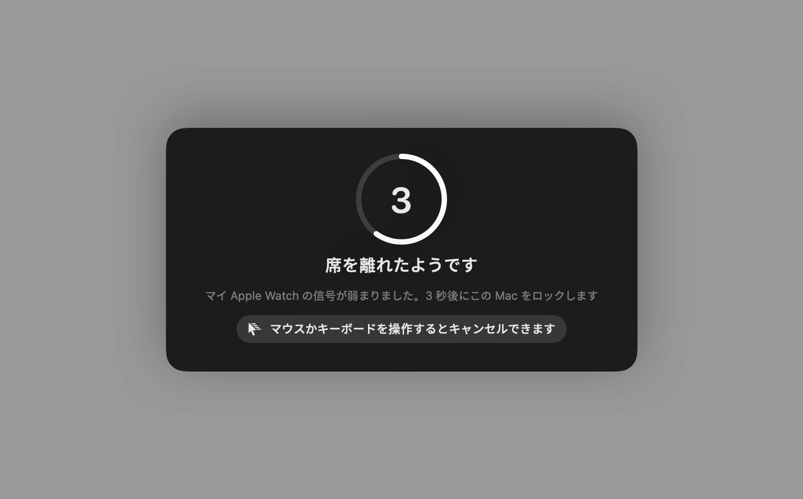

<p align="center">
  
</p>

<h1 align="center">Doorman</h1>

<p align="center">席を離れると、Mac が自動でロックされます。</p>

<p align="center">
  <a href="README.md">English</a> · <a href="README.zh-CN.md">简体中文</a> · <b>日本語</b> · <a href="https://hodgekou.github.io/doorman/">Web サイト</a>
</p>

---

Doorman は macOS のメニューバーに常駐する小さなアプリです。身につけている Apple Watch や iPhone で、あなたが Mac のそばにいるかを判断します。席を離れれば Mac をロックし、タイピングやマウス操作をしている間は決してロックしません。戻ったら、いつもどおり Apple Watch、Touch ID、またはパスワードでロックを解除してください。

<p align="center">
  
</p>

## 機能

- **離れたらロック** — 時計やスマートフォンへのインストールは不要です。
- **作業中はロックしない** — キーボード・マウス・トラックパッドを操作している間はロックされません。
- **ロック前にカウントダウン** — ロックの 5 秒前にお知らせ。マウスを動かせばキャンセルできます。
- **パスワードには触れない** — Doorman はロックするだけで、パスワードを保存したり入力したりしません。
- **信号が見える** — デバイスの信号をリアルタイムで表示。感度は「敏感 / 標準 / ゆるめ」から選べます。
- **3 か国語に対応** — 日本語・English・简体中文をいつでも切り替えられます。

| メニューバー | ロック前のカウントダウン |
|---|---|
|  |  |

## 動作環境

- macOS 13 以降
- Apple Watch または iPhone（Mac と同じ Apple ID でサインインしているのが理想）

## インストール

現在はソースからインストールします。3 分ほどで終わります。

1. 「ターミナル」を開き、Apple のコマンドラインツールをインストールします（インストール済みならスキップできます）：

   ```sh
   xcode-select --install
   ```

2. Doorman をダウンロードしてインストールします：

   ```sh
   git clone https://github.com/hodgekou/doorman.git
   cd doorman
   scripts/install.sh
   ```

   Doorman が「アプリケーション」にインストールされ、自動で起動します。

3. 「開けません」と表示された場合は、Finder の「アプリケーション」で Doorman を右クリックし、「開く」を選んでください。

**アップデート**：`doorman` フォルダで `git pull` を実行し、もう一度 `scripts/install.sh` を実行します。

## 使い方

1. **初回ガイドに沿って進める** — Bluetooth と通知を許可し、時計またはスマートフォンを選びます。テストロックも試せます。
2. **あとは任せるだけ** — Doorman は画面右上のメニューバーにいます。アイコンをクリックすると状態や信号を確認でき、「今すぐロック」や「一時停止」もできます。
3. **戻ったらロック解除** — 「システム設定 › Touch ID とパスワード」で「Apple Watch でロック解除」をオンにしておけば、戻って画面をスリープ解除するだけです。
4. **調整する** — メニューバーのアイコン › 設定…
   - 「離席検知」：ロックが早すぎる・遅すぎるときは感度を変えます。
   - 「デバイス」：デバイスを変更したり、わかりやすい名前を付けたりできます。
   - 「一般」：言語の切り替えや、ログイン時の起動を設定できます。


## よくある質問

**何も触らずに画面を読んでいるとロックされますか？**
デバイスの信号も弱くなった場合に限ります。まず 5 秒のカウントダウンが表示され、マウスを動かせばキャンセルできます。

**戻ったときに Doorman がロック解除しないのはなぜですか？**
Bluetooth の信号は偽装できるため、ロック解除に使うのは安全ではありません。macOS 標準の「Apple Watch でロック解除」のほうがはるかに安全なので、解除はシステムに任せています。

**時計とスマートフォン、どちらがよいですか？**
常に手首にある Apple Watch がおすすめです。スマートフォンも使えますが、机に置いたまま離れると信号が強いままなので、ロックされません。

**Bluetooth の許可をまた求められました。**
再インストールのたびに確認されることがあります。許可してください。

**データは送信されますか？**
いいえ。Doorman はネットワークを使いません。直近 30 日分のロック履歴を Mac 内に保存するだけで、キー入力の内容も記録しません。

## アンインストール

1. メニューバーのアイコン › Doorman を終了。
2. 「アプリケーション」の Doorman をゴミ箱に入れます。
3. 設定と履歴も削除する場合は、ターミナルで次を実行します：

   ```sh
   defaults delete dev.doorman.Doorman
   rm -rf ~/Library/Application\ Support/Doorman
   ```

## フィードバック

問題や提案があれば、[Issue](https://github.com/hodgekou/doorman/issues) からお知らせください。

[BLEUnlock](https://github.com/ts1/BLEUnlock) から着想を得ています。
