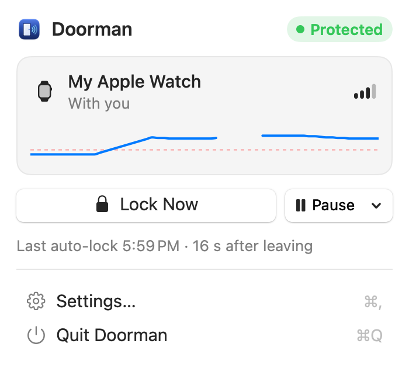
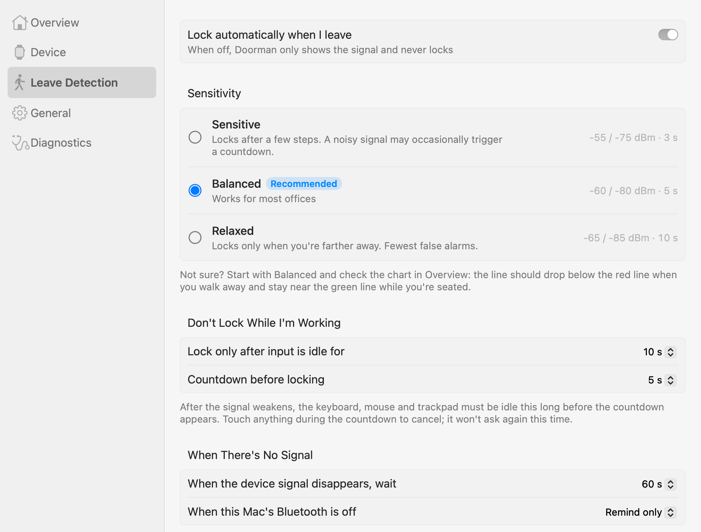

<p align="center">
  
</p>

<h1 align="center">Doorman</h1>

<p align="center">Walk away, and your Mac locks itself.</p>

<p align="center">
  <b>English</b> · <a href="README.zh-CN.md">简体中文</a> · <a href="README.ja.md">日本語</a> · <a href="https://hodgekou.github.io/doorman/">Website</a>
</p>

---

Doorman is a small macOS menu bar app. It uses the Apple Watch or iPhone you carry to tell whether you're at your Mac: walk away and the Mac locks; keep typing and it never will. When you come back, unlock the way you already do — Apple Watch, Touch ID or your password.

<p align="center">
  
</p>

## Features

- **Locks when you leave** — nothing to install on your watch or phone.
- **Never locks while you work** — as long as you're using the keyboard, mouse or trackpad, it won't lock.
- **A countdown first** — a 5-second warning before locking; move the mouse to cancel.
- **Doesn't touch your password** — Doorman only locks. It never stores or types your password.
- **See the signal** — a live chart of your device's signal, and three sensitivity presets: Sensitive, Balanced, Relaxed.
- **Three languages** — English, 简体中文 and 日本語, switchable any time.

| Menu bar | Countdown before locking |
|---|---|
|  |  |

## Requirements

- macOS 13 or later
- An Apple Watch or iPhone (ideally signed in to the same Apple ID as your Mac)

## Install

For now, Doorman is installed from source. It takes about 3 minutes.

1. Open Terminal and install Apple's command line tools (skip this if they're already installed):

   ```sh
   xcode-select --install
   ```

2. Download and install Doorman:

   ```sh
   git clone https://github.com/hodgekou/doorman.git
   cd doorman
   scripts/install.sh
   ```

   Doorman is installed in Applications and opens automatically.

3. If macOS says it can't be opened, right-click Doorman in Applications in Finder and choose **Open**.

**Update:** run `git pull` in the `doorman` folder, then run `scripts/install.sh` again.

## How to use

1. **Follow the first-run guide** — allow Bluetooth and notifications, pick your watch or phone, and try a test lock if you like.
2. **Then forget about it** — Doorman lives in the menu bar at the top right. Click its icon to see the status and signal, lock now, or pause for a while.
3. **Unlock when you're back** — turn on *Unlock with Apple Watch* in *System Settings › Touch ID & Password*, then just wake the screen when you return.
4. **Adjust** — click the menu bar icon › Settings…
   - *Leave Detection*: pick another sensitivity if it locks too soon or too late.
   - *Device*: switch devices, or give yours a friendlier name.
   - *General*: change the language or open Doorman at login.



## FAQ

**Will it lock while I'm reading without touching anything?**
Only if your device's signal also drops. You'll see a 5-second countdown first; move the mouse to cancel.

**Why doesn't Doorman unlock my Mac when I come back?**
Bluetooth signals can be spoofed, so unlocking with them isn't safe. macOS's own Apple Watch Unlock is far more secure, so Doorman leaves unlocking to it.

**Watch or phone?**
An Apple Watch works best because it's always on your wrist. A phone works too, but if you leave it on the desk its signal stays strong after you walk away, so your Mac won't lock.

**macOS asks for Bluetooth access again?**
It may ask after each reinstall. Just allow it.

**Is any of my data uploaded?**
No. Doorman doesn't use the network. It keeps the last 30 days of lock history on your Mac and never records what you type.

## Uninstall

1. Click the menu bar icon › Quit Doorman.
2. Move Doorman from Applications to the Trash.
3. To also remove settings and history, run in Terminal:

   ```sh
   defaults delete dev.doorman.Doorman
   rm -rf ~/Library/Application\ Support/Doorman
   ```

## Feedback

Found a problem or have an idea? Please open an [issue](https://github.com/hodgekou/doorman/issues).

Inspired by [BLEUnlock](https://github.com/ts1/BLEUnlock).
