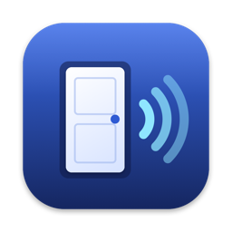
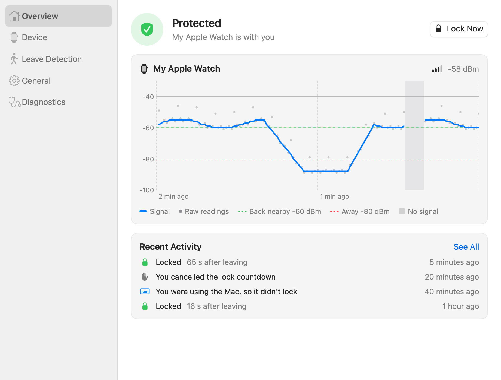
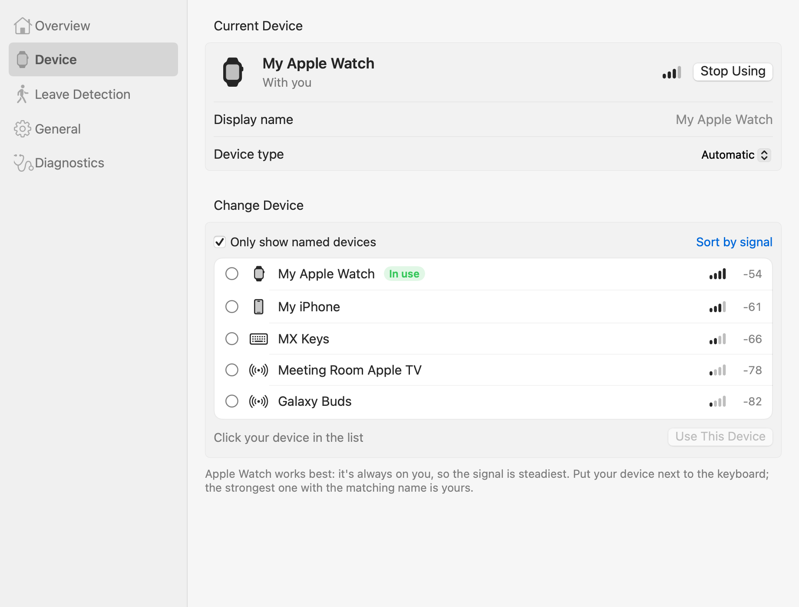
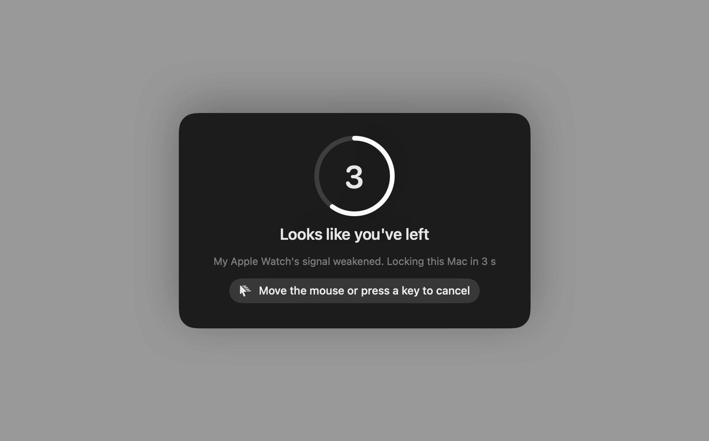
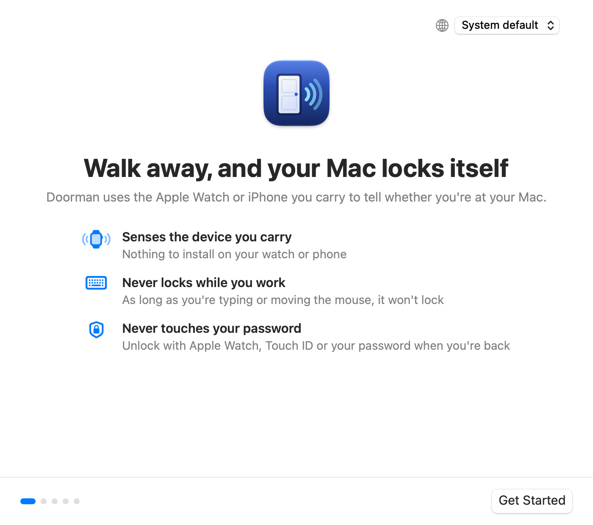

<p align="center">
  
</p>

<h1 align="center">Doorman</h1>

<p align="center">Walk away, and your Mac locks itself.</p>

<p align="center">
  <b>English</b> · <a href="README.zh-CN.md">简体中文</a> · <a href="README.ja.md">日本語</a> · <a href="https://hodgekou.github.io/doorman/">Website</a>
</p>

---

Doorman is a lightweight macOS menu bar app. It watches the Bluetooth signal of the Apple Watch or iPhone you carry, and locks your Mac when you walk away. When you come back, you unlock with macOS itself — Apple Watch Unlock, Touch ID or your password. Doorman never stores or types your login password.

> **Status:** early development (M1). Locking still needs validation on more real hardware — see [Roadmap](#roadmap).

## Screenshots

| Menu bar | Overview |
|---|---|
|  |  |

| Choose a device | Leave detection |
|---|---|
|  |  |

| Lock countdown | First-run guide |
|---|---|
|  |  |

## Features

- **Locks when you leave.** Uses the signal of the Apple Watch or iPhone you already carry. Nothing to install on the watch or phone.
- **Never locks while you are working.** Recent keyboard, mouse or trackpad activity vetoes auto-lock. Before locking, a 5-second countdown appears; any input cancels it. The idle time is read again right before the lock call, so input in the last moment still counts.
- **Doesn't touch your password.** Unlocking is left to macOS: Apple Watch Unlock, Touch ID or password.
- **Honest status.** The menu bar always tells you whether auto-lock is available, remind-only, or not ready — and how to fix it.
- **Live signal chart and simple presets.** See the last two minutes of signal, and pick Sensitive / Balanced / Relaxed instead of tuning dBm values.
- **Local diagnostics only.** Each lock attempt is logged on your Mac (30 days, 500 entries max). Nothing leaves your computer.
- **English, 简体中文 and 日本語.** Follows your system language by default; switch any time under *Settings › General*, and it takes effect immediately.

## How it works

```
Bluetooth RSSI ─▶ median filter ─▶ presence: near / leaving / away / lost
                                        │ "wants to lock"
                                        ▼
                     activity guard: keyboard/mouse idle ≥ 10 s?
                       no  → hold, keep watching
                       yes → 5 s countdown (any input cancels this round)
                                        │
                                        ▼
            pre-lock check: re-read idle time, round ID, session state
                                        │
                                        ▼
                     lock the screen ─▶ confirm via session signals
```

- Signal strength (RSSI) is only a rough proximity signal. Two thresholds with a gap between them (default −60 / −80 dBm) prevent flapping.
- If the device signal disappears entirely, Doorman waits 60 seconds (configurable) before treating it as lost.
- After sleep, Doorman re-samples before judging. If the device is not found within 15 seconds, it reports "not ready" instead of locking.

## Requirements

- macOS 13 Ventura or later, Apple silicon or Intel
- A Mac with Bluetooth LE
- An Apple Watch or iPhone (ideally signed in to the same Apple ID as the Mac), or another Bluetooth LE device with a stable address

## Install

Doorman is not notarized yet, so build it from source. Only the Xcode Command Line Tools are needed.

```sh
git clone https://github.com/hodgekou/doorman.git
cd doorman
scripts/install.sh    # builds, installs to /Applications/Doorman.app, and launches it
```

The app is ad-hoc signed. If macOS blocks the first launch, right-click Doorman in Finder and choose **Open**. Grant **Bluetooth** (required) and **Notifications** (recommended) when asked. Rebuilding changes the signature, so macOS may ask again.

## Usage

1. The first-run guide walks you through permissions, choosing your device, and a test lock.
2. Keep the default **Balanced** sensitivity, then check the chart in **Overview**: the line should drop below the red line when you walk away, and sit near the green line while you are at your desk.
3. Turn on **Unlock with Apple Watch** in *System Settings › Touch ID & Password* for a hands-free return.
4. Use **Pause** in the menu bar when you want Doorman to stop watching for a while.
5. Change the interface language under *Settings › General › Language*.

## Security notes

- **Signal strength is not authentication.** Bluetooth advertisements can be spoofed. That is why Doorman only locks and never unlocks.
- The default lock method calls the private `SACLockScreenImmediate` function. It cannot ship on the Mac App Store and may break in a future macOS. Other methods can be selected under *Diagnostics*.
- Idle time is read with `CGEventSource.secondsSinceLastEventType` — timestamps only, never keystrokes.
- Devices are remembered by their CoreBluetooth identifier on this Mac. Doorman does not read private Bluetooth databases.

## Development

```sh
swift build                 # build
scripts/test.sh             # core logic tests (swift-testing)
scripts/build-app.sh        # package dist/Doorman.app
scripts/install.sh          # package and install to /Applications
scripts/make-icon.sh        # regenerate the app icon
```

```
Sources/DoormanCore/   Pure logic, no AppKit/CoreBluetooth: filter, presence machine,
                       activity guard, pre-lock check, attempt tracking, diagnostics
Sources/Doorman/       Menu bar app: Bluetooth, session observer, lock methods, UI
  Localization/        English and Japanese string tables (keys are the Chinese source text)
Tests/                 Unit tests and trace replays for the "never lock while active" rules
Support/               Info.plist, entitlements, icon
docs/                  GitHub Pages site
```

Render UI screenshots with sample data (no Bluetooth, no settings written):

```sh
scripts/build-app.sh debug
DOORMAN_SNAPSHOT_DIR=/tmp/doorman-snap dist/Doorman.app/Contents/MacOS/Doorman
```

With only the Command Line Tools installed, SwiftUI's `@State` macro is unavailable, so view-local state uses `ObservableObject` + `@StateObject`.

### Localization

The UI supports English, Simplified Chinese and Japanese, switchable at runtime. Wrap every user-facing string in `L("中文原文")` (or `L("…%@…", value)` for formatted text) and add the English and Japanese translations to `Sources/Doorman/Localization/Strings.en.swift` and `Strings.ja.swift`. Then run:

```sh
scripts/check-l10n.sh      # reports missing translations and mismatched placeholders
```

The system Bluetooth permission prompt is localized separately through `Support/Localization/*.lproj/InfoPlist.strings`.

## Roadmap

- [x] Single-device loop: presence, activity guard, pre-lock check, lock confirmation
- [x] Menu bar popover, settings, first-run guide, live signal chart
- [ ] Real-hardware validation: lock trigger and confirmation, long-term sampling, input coverage of the idle check
- [ ] Per-device calibration wizard
- [ ] Developer ID signing, notarization and a Homebrew cask
- [ ] Multiple devices (opt-in), event scripts (off by default)
- [x] English, Simplified Chinese and Japanese UI with in-app switching

## Acknowledgements

Inspired by [BLEUnlock](https://github.com/ts1/BLEUnlock). Doorman is a from-scratch rewrite with a different design: it only locks, and puts "never lock while you are working" first.
