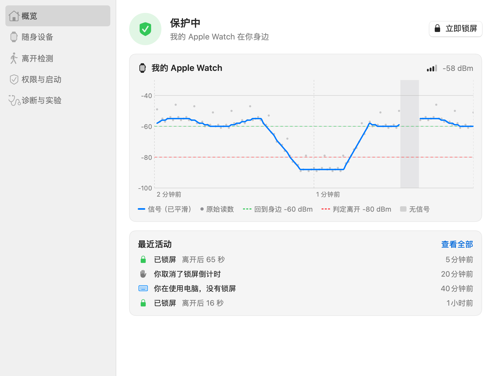
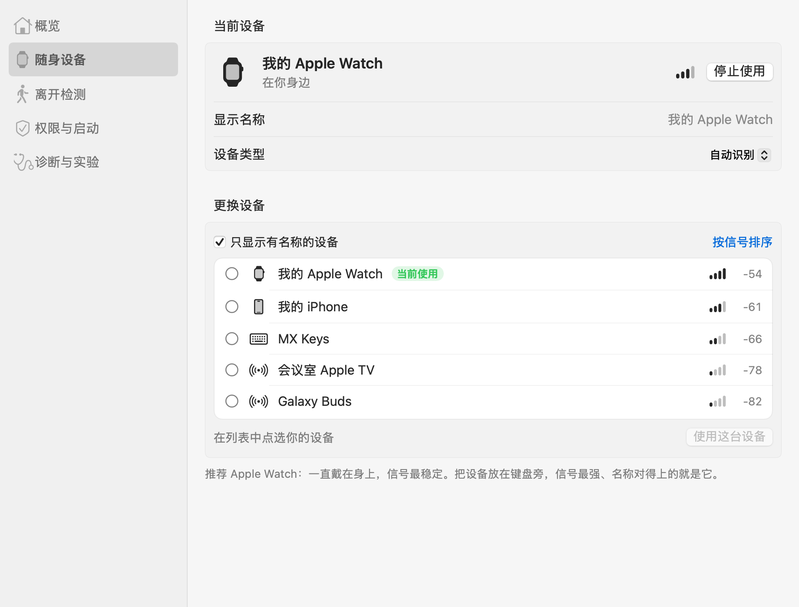
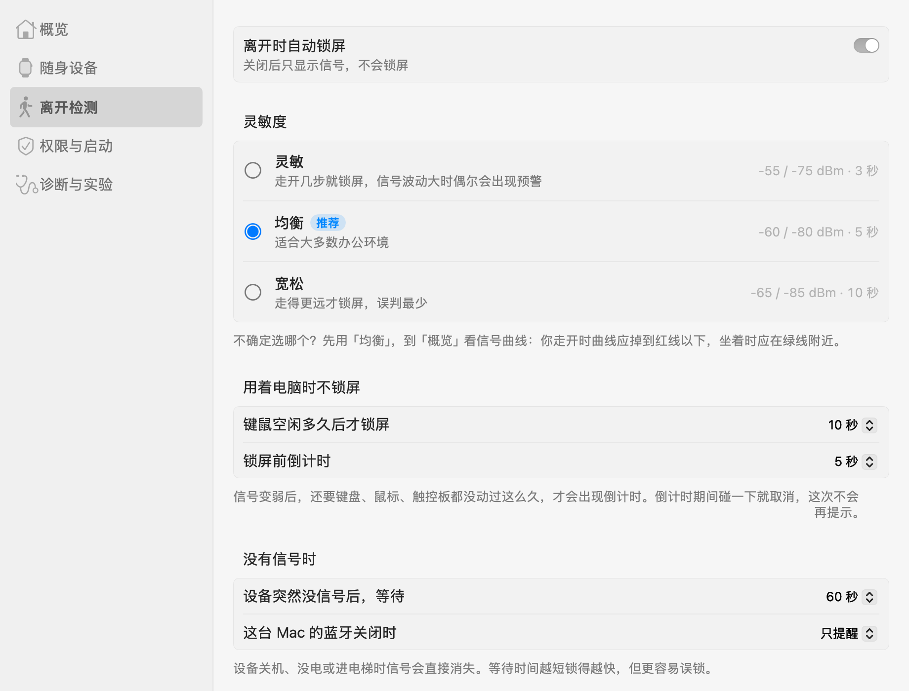
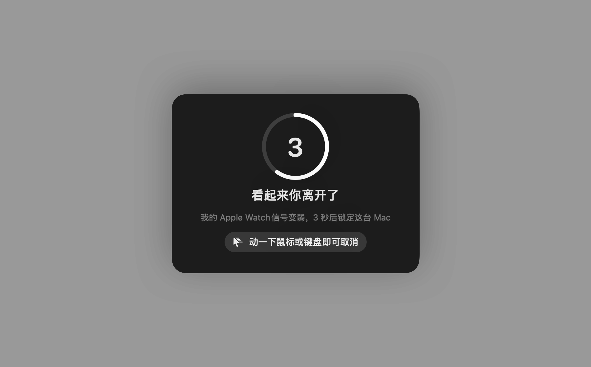
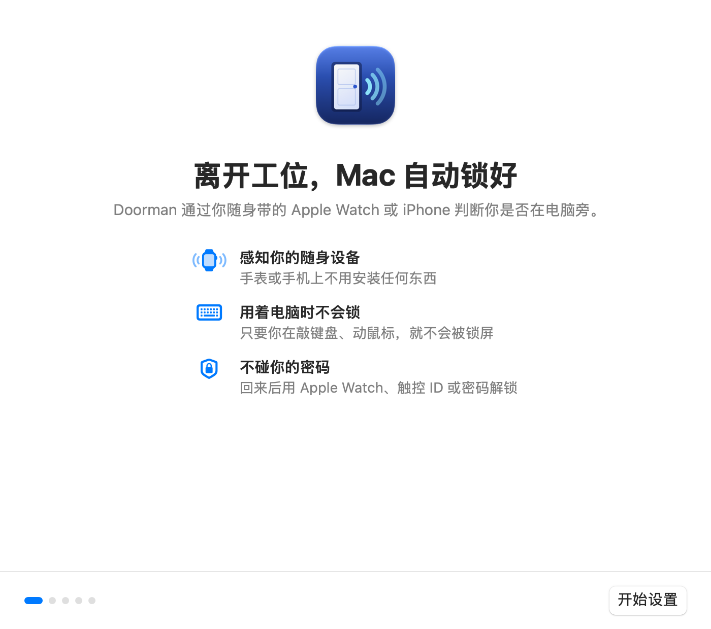

<p align="center">
  
</p>

<h1 align="center">Doorman</h1>

<p align="center">离开工位，Mac 自动锁好。</p>

<p align="center">
  <a href="README.md">English</a> · <b>简体中文</b> · <a href="README.ja.md">日本語</a> · <a href="https://hodgekou.github.io/doorman/">官网</a>
</p>

---

Doorman 是一个轻量的 macOS 菜单栏工具。它通过你随身带的 Apple Watch 或 iPhone 的蓝牙信号判断你是否在电脑旁，离开时自动锁定 Mac。回来后用 macOS 自己的方式解锁：用 Apple Watch 解锁、触控 ID 或密码。Doorman 不保存、也不会替你输入登录密码。

> **当前状态：** 早期开发（M1）。界面目前只有简体中文。锁屏行为还需要在更多真机上验证，见[路线图](#路线图)。

## 截图

| 菜单栏 | 概览 |
|---|---|
|  |  |

| 选择设备 | 离开检测 |
|---|---|
|  |  |

| 锁屏倒计时 | 首次引导 |
|---|---|
|  |  |

## 功能

- **离开就锁。** 用你本来就随身带的 Apple Watch 或 iPhone 的信号判断，手表、手机上不用装任何东西。
- **用着电脑时不会锁。** 最近有键盘、鼠标、触控板操作就不会自动锁屏。真正锁屏前有 5 秒倒计时，碰一下即取消。调用锁屏前一刻还会再读一次空闲时长，最后一刻的操作同样有效。
- **不碰你的密码。** 解锁交给 macOS：用 Apple Watch 解锁、触控 ID 或密码。
- **状态如实显示。** 菜单栏随时告诉你：自动锁屏可用、仅提醒，还是监控未就绪，以及怎么修复。
- **实时信号图和三档预设。** 看最近 2 分钟的信号曲线；灵敏度选「灵敏 / 均衡 / 宽松」，不用手调 dBm。
- **诊断只存在本机。** 每次锁屏尝试都记录在你的 Mac 上（最近 30 天、最多 500 条），不会上传。

## 工作原理

```
蓝牙 RSSI ─▶ 中值滤波 ─▶ 在场状态：在场 / 离开中 / 已离开 / 失联
                                │ 想要锁屏
                                ▼
            活动守卫：键鼠空闲 ≥ 10 秒？
              否 → 拦截，继续观察
              是 → 5 秒倒计时（任何操作都会取消这一轮）
                                │
                                ▼
        执行前复核：现读空闲时长、核对轮次号和会话状态
                                │
                                ▼
                锁屏 ─▶ 通过会话信号确认已锁
```

- 信号强度（RSSI）只是粗略的接近度信号。两个阈值之间留有间隔（默认 −60 / −80 dBm），避免在临界距离来回切换。
- 设备信号完全消失时，等待 60 秒（可调）才判定失联。
- 睡眠唤醒后先重新采样再判断；15 秒内找不到设备会显示「监控未就绪」，不会锁屏。

## 系统要求

- macOS 13 Ventura 或更新版本，Apple 芯片或 Intel
- 支持低功耗蓝牙的 Mac
- Apple Watch 或 iPhone（最好与 Mac 登录同一个 Apple ID），或其他地址固定的低功耗蓝牙设备

## 安装

Doorman 尚未公证，请从源码构建。只需要 Xcode Command Line Tools。

```sh
git clone https://github.com/hodgekou/doorman.git
cd doorman
scripts/install.sh    # 构建、安装到 /Applications/Doorman.app 并启动
```

App 使用 ad-hoc 签名。首次启动如果被系统拦截，在访达中右键点 Doorman，选择「打开」。按提示允许**蓝牙**（必需）和**通知**（建议）。重新构建后签名会变化，系统可能会再次请求授权。

## 使用

1. 首次引导会带你完成授权、选择设备和一次测试锁屏。
2. 灵敏度先用默认的「均衡」，然后到「概览」看信号曲线：你走开时曲线应掉到红线以下，坐在工位时应在绿线附近。
3. 在「系统设置 › 触控 ID 与密码」中开启「用 Apple Watch 解锁」，回来时无需输入密码。
4. 想让 Doorman 暂时停止，在菜单栏点「暂停」。

## 安全说明

- **信号强度不是身份认证。** 蓝牙广播可以被伪造，所以 Doorman 只锁屏，从不解锁。
- 默认锁屏方式调用私有函数 `SACLockScreenImmediate`，不能上架 Mac App Store，未来系统升级可能失效。可在「诊断与实验」中切换其他方式。
- 键鼠空闲时长通过 `CGEventSource.secondsSinceLastEventType` 读取，只读时间戳，不记录按键内容。
- 设备通过它在这台 Mac 上的 CoreBluetooth 标识记住。Doorman 不读取系统私有蓝牙数据库。

## 开发

```sh
swift build                 # 编译
swift test                  # 核心逻辑单测（swift-testing）
scripts/build-app.sh        # 打包 dist/Doorman.app
scripts/install.sh          # 打包并安装到 /Applications
scripts/make-icon.sh        # 重新生成 App 图标
```

```
Sources/DoormanCore/   纯逻辑，不依赖 AppKit / CoreBluetooth：滤波、在场状态机、
                       活动守卫、执行前复核、锁屏尝试追踪、诊断记录
Sources/Doorman/       菜单栏 App：蓝牙、会话观察、锁屏方式、界面
Tests/                 单测，以及「用着电脑时不会锁」的轨迹回放
Support/               Info.plist、entitlements、图标
docs/                  GitHub Pages 网站
```

用示例数据渲染界面截图（不启动蓝牙，不写入用户设置）：

```sh
scripts/build-app.sh debug
DOORMAN_SNAPSHOT_DIR=/tmp/doorman-snap dist/Doorman.app/Contents/MacOS/Doorman
```

只装了 Command Line Tools 时，SwiftUI 的 `@State` 宏不可用，界面局部状态统一用 `ObservableObject` + `@StateObject`。

## 路线图

- [x] 单设备闭环：在场判断、活动守卫、执行前复核、锁屏确认
- [x] 菜单栏弹出窗口、设置窗口、首次引导、实时信号图
- [ ] 真机验证：锁屏触发与确认、长期采样、键鼠空闲读取的覆盖范围
- [ ] 按设备校准向导
- [ ] Developer ID 签名、公证与 Homebrew Cask
- [ ] 多设备（需手动开启）、事件脚本（默认关闭）
- [ ] 英文、日文界面

## 致谢

灵感来自 [BLEUnlock](https://github.com/ts1/BLEUnlock)。Doorman 从零重写，设计取向不同：只负责锁屏，并把「用着电脑时绝不锁屏」放在第一位。
