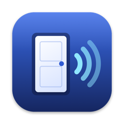
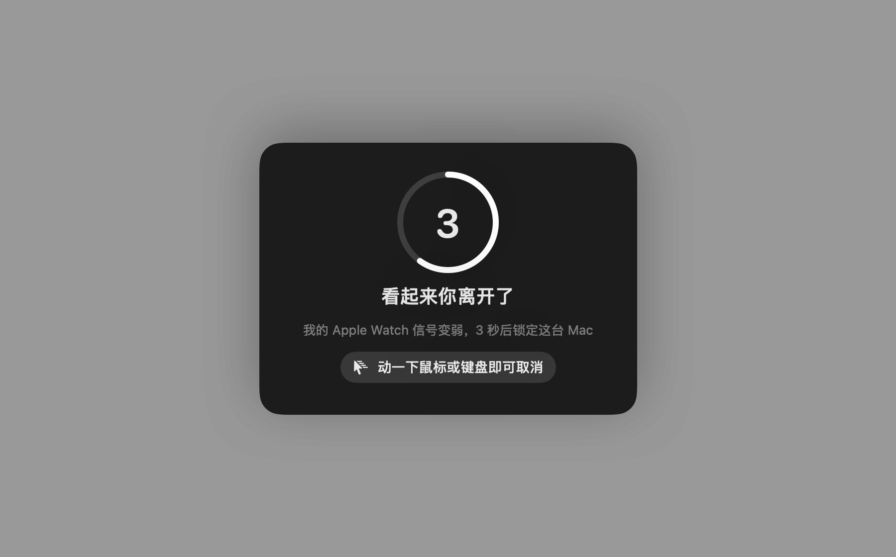
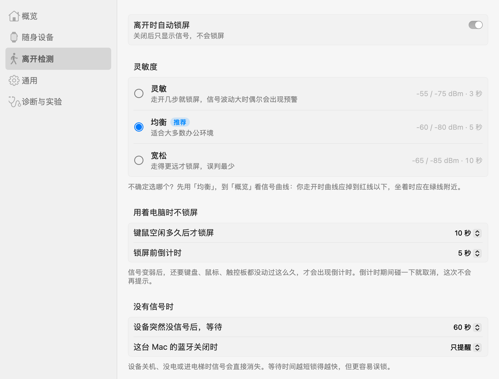

<p align="center">
  
</p>

<h1 align="center">Doorman</h1>

<p align="center">离开工位，Mac 自动锁好。</p>

<p align="center">
  <a href="README.md">English</a> · <b>简体中文</b> · <a href="README.ja.md">日本語</a> · <a href="https://hodgekou.github.io/doorman/">官网</a>
</p>

---

Doorman 是一个 macOS 菜单栏小工具。它通过你随身带的 Apple Watch 或 iPhone 判断你是否在电脑旁：离开工位，Mac 自动锁屏；正在打字、动鼠标时，绝不会锁。回来后用 macOS 自己的方式解锁——用 Apple Watch 解锁、触控 ID 或密码。

<p align="center">
  
</p>

## 功能

- **离开就锁**：手表、手机上不用装任何东西。
- **用着电脑时不会锁**：只要你在操作键盘、鼠标或触控板，就不会被锁屏。
- **锁屏前有倒计时**：锁屏前 5 秒提示，动一下鼠标就取消。
- **不碰你的密码**：Doorman 只负责锁屏，不保存、也不会替你输入密码。
- **看得见信号**：实时显示设备信号，灵敏度有「灵敏 / 均衡 / 宽松」三档可选。
- **三种语言**：简体中文、English、日本語，随时切换。

| 菜单栏 | 锁屏前倒计时 |
|---|---|
|  |  |

## 系统要求

- macOS 13 或更新版本
- Apple Watch 或 iPhone（建议与 Mac 登录同一个 Apple ID）

## 安装

Doorman 目前需要从源码安装，大约 3 分钟。

1. 打开「终端」，安装 Apple 的命令行工具（已经装过的会提示已安装，可跳过）：

   ```sh
   xcode-select --install
   ```

2. 下载并安装 Doorman：

   ```sh
   git clone https://github.com/hodgekou/doorman.git
   cd doorman
   scripts/install.sh
   ```

   安装完成后，Doorman 会出现在「应用程序」中并自动打开。

3. 如果 macOS 提示无法打开，在访达的「应用程序」里右键点 Doorman，选择「打开」。

**更新**：在 `doorman` 目录里运行 `git pull`，再运行一次 `scripts/install.sh`。

## 使用

1. **跟着首次引导走一遍**：允许蓝牙和通知，选择你的手表或手机，可以顺便试锁一次。
2. **之后就不用管了**：Doorman 待在屏幕右上角的菜单栏里。点图标可以看到当前状态、设备信号，也可以「立即锁屏」或「暂停」一段时间。
3. **回来时解锁**：推荐在「系统设置 › 触控 ID 与密码」里开启「用 Apple Watch 解锁」，戴着手表回来，唤醒屏幕即可。
4. **调整**：点菜单栏图标 › 设置…
   - 「离开检测」：锁得太快或太慢时换一档灵敏度。
   - 「随身设备」：更换设备，或给设备起个好认的名字。
   - 「通用」：切换语言、开启登录时自动启动。



## 常见问题

**我只看屏幕、不碰键鼠时会被锁吗？**
只有设备信号同时变弱时才会。锁屏前会先出现 5 秒倒计时，动一下鼠标就取消。

**为什么回来时 Doorman 不帮我解锁？**
蓝牙信号可以被伪造，用它解锁不安全。macOS 自带的「用 Apple Watch 解锁」安全得多，所以解锁交给系统。

**用手表还是手机好？**
推荐 Apple Watch，它一直戴在手上。手机也可以，但如果手机放在桌上，你走开后它的信号依然很强，就不会锁屏。

**系统再次请求蓝牙权限？**
每次重新安装后系统可能会再问一次，允许即可。

**我的数据会被上传吗？**
不会。Doorman 不联网，只在本机保存最近 30 天的锁屏记录，也不会记录你的按键内容。

## 卸载

1. 点菜单栏图标 › 退出 Doorman。
2. 把「应用程序」里的 Doorman 移到废纸篓。
3. 如需同时删除设置和记录，在终端运行：

   ```sh
   defaults delete dev.doorman.Doorman
   rm -rf ~/Library/Application\ Support/Doorman
   ```

## 反馈

遇到问题或有建议，欢迎提 [Issue](https://github.com/hodgekou/doorman/issues)。

灵感来自 [BLEUnlock](https://github.com/ts1/BLEUnlock)。
